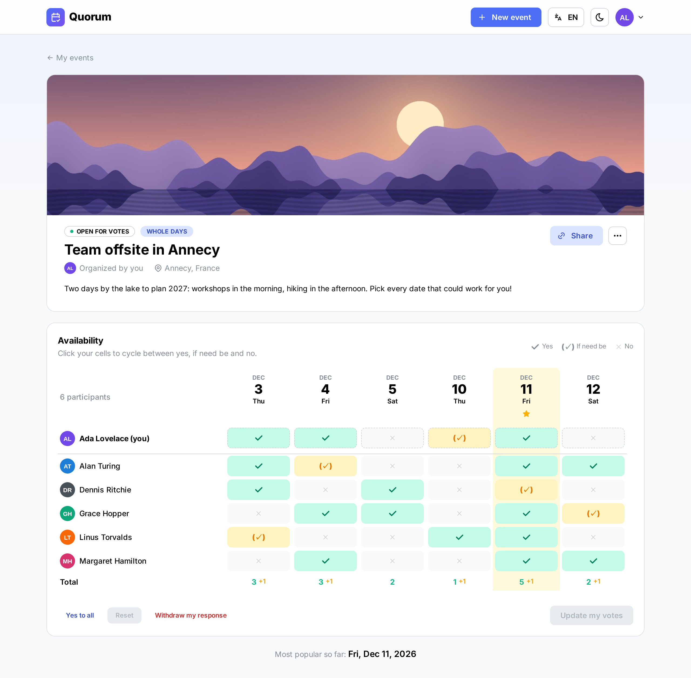

# Quorum

Find the time that works for everyone. Propose dates or time slots, share the link, and let people vote.

<picture>
  <source media="(prefers-color-scheme: dark)" srcset="docs/screenshot-dark.png">
  
</picture>

- Google sign-in
- Whole days or time slots of any length
- Yes / if need be / no votes, with the best option highlighted
- Cover images, light and dark themes, English and French

## Run it

You need a Google OAuth client with `https://<your-host>/auth/callback` as a redirect URI, and [Traefik](https://traefik.io/) on the `traefik` Docker network.

```sh
cp .env.example .env   # set QUORUM_HOST, GOOGLE_CLIENT_ID and GOOGLE_CLIENT_SECRET
docker compose up -d
```

Without Docker, run `quorum serve --help` to see every option.

## Develop

```sh
docker build --target demo -t quorum:demo .
docker run -p 9090:9090 quorum:demo   # http://localhost:9090, sign in with a fake Google profile
```

Go backend (`cmd/`, `internal/`) and React/Mantine frontend (`web/`). `golangci-lint run && go test ./...` checks the backend, and `npm run lint && npm test` (in `web/`) checks the frontend.

## License

[MIT](LICENSE)
